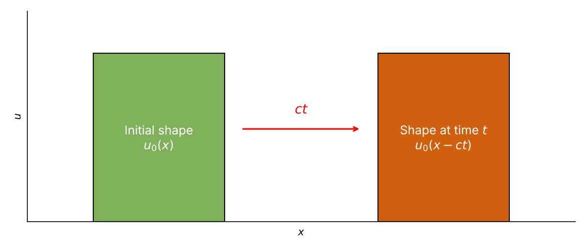
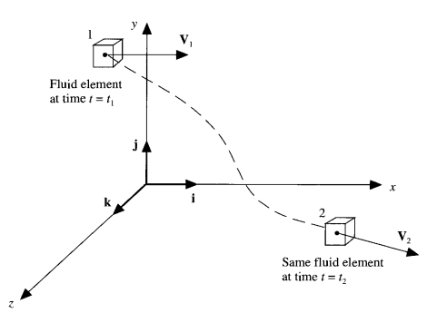
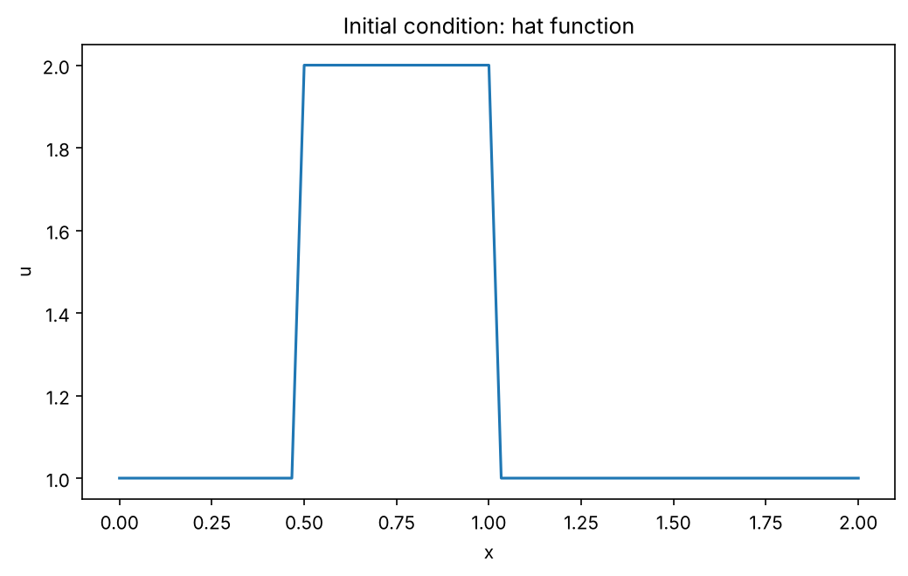
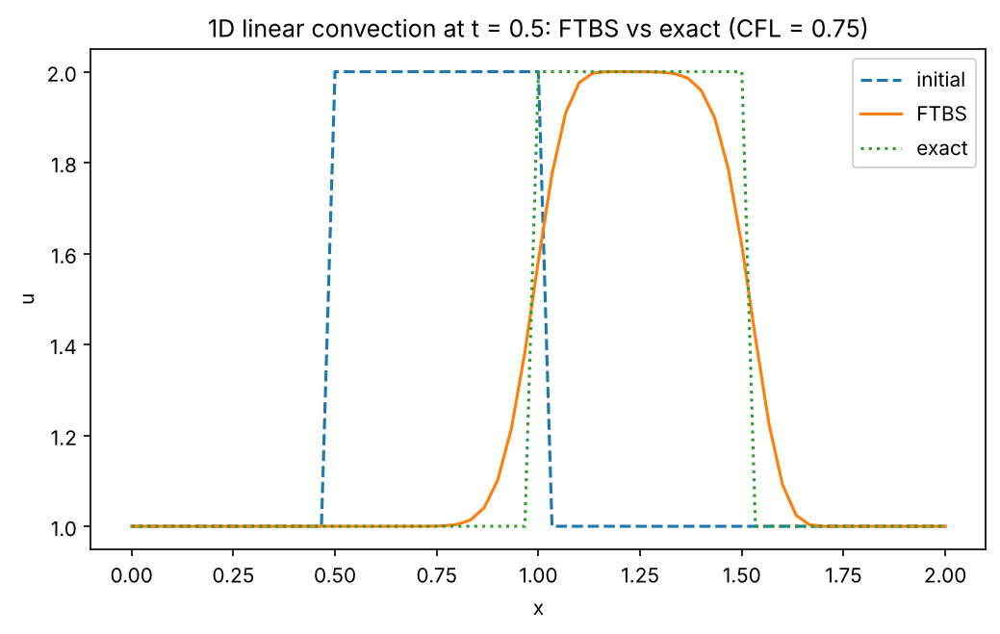

# 1D Linear Convection: Derivation, Exact Solution and an Upwind Finite-Difference Scheme in Python

A Jupyter notebook that derives the 1D linear convection equation, gives its exact solution by the method of characteristics, implements an explicit finite-difference scheme (forward in time, backward/upwind in space, "FTBS") in Python, and compares the numerical result with the exact solution.

## Equation

$$\frac{\partial u}{\partial t} + c\,\frac{\partial u}{\partial x} = 0$$

where $u(x,t)$ is the transported quantity and $c > 0$ is a constant wave speed. The exact solution is a pure translation of the initial profile:

$$u(x,t) = u_0(x - ct)$$



The equation follows from setting the material derivative of $u$ to zero, $Du/Dt = 0$. The notebook derives the material derivative from a Taylor series expansion of a property carried by a moving fluid element:



## Numerical scheme (FTBS)

Forward difference in time and backward (upwind) difference in space give the explicit update

$$u_i^{n+1} = u_i^n - c\,\frac{\Delta t}{\Delta x}\left(u_i^n - u_{i-1}^n\right)$$

The scheme is stable when the CFL number $\sigma = c\,\Delta t/\Delta x \le 1$.

The update is in conservative form, with the upwind numerical flux $F_{i+1/2}^n = c\,u_i^n$. The flux leaving one cell is the flux entering the next, so the total amount of $u$ (the area under the curve) changes only through the boundaries.

## Test case

| Item | Value |
|---|---|
| Domain | $x \in [0, 2]$ |
| Grid | $n_x = 61$ points, $\Delta x = 2/60$ |
| Time stepping | $n_t = 20$ steps of $\Delta t = 0.025$ (final time $t = 0.5$) |
| Wave speed | $c = 1$ |
| CFL number | $\sigma = 0.75$ |
| Initial condition | hat function: $u = 2$ for $0.5 \le x \le 1$, $u = 1$ elsewhere |
| Boundary | $u$ at $x = 0$ is held at 1 (inflow); the wave does not reach $x = 2$ before $t = 0.5$ |

Initial condition:



## Results



At $t = 0.5$ the exact solution is the initial hat shifted right by $ct = 0.5$. The FTBS solution is in the right position, but its sharp edges are smeared. This is numerical diffusion, the expected weakness of a first-order upwind scheme. The modified equation of FTBS shows why: the scheme behaves like convection plus a diffusion term with numerical viscosity $\tfrac{c\,\Delta x}{2}(1-\sigma)$, about 0.004 for this run. For this run:

- L1 error against the exact solution, $\Delta x \sum_i |u_i - u_i^\text{exact}|$: 0.101
- Area under the curve, $\Delta x \sum_i u_i$: 2.567 initially, 2.567 for FTBS and 2.567 for the exact solution, so the total is preserved while the wave is away from the boundaries. The total is preserved, but the shape is not.

## What the notebook contains

1. The 1D linear convection equation, its physical meaning, and how it relates to the Navier-Stokes equations under simplifying assumptions.
2. Derivation from the material (substantial) derivative using a Taylor series expansion.
3. The exact solution by the method of characteristics.
4. The FTBS discretization, the upwind argument, and the CFL (grid ratio) stability condition.
5. Python implementation: grid and parameter set-up, hat-function initial condition, FTBS time-stepping loop, exact solution, error and area diagnostics, and a plot comparing the three, followed by a discussion of numerical diffusion.

## Repository contents

```
01_1d_linear_convection.ipynb
README.md
requirements.txt
LICENSE
figures/
    convection_translation.png
    material_derivative.png
    initial_condition.png
    ftbs_vs_exact.png
```

The notebook writes `initial_condition.png` and `ftbs_vs_exact.png` into `figures/` when it is run. The README images need the `figures/` folder to be in the repository next to `README.md`.

## How to run

```bash
git clone https://github.com/Mintesinot-A/linear-convection-upwind-python.git
cd linear-convection-upwind-python
pip install -r requirements.txt
jupyter lab
```

Open `01_1d_linear_convection.ipynb` and choose **Kernel → Restart Kernel and Run All Cells**.

Suggested experiments: change `nx` with `dt` fixed and watch the CFL number and the solution change. `nx = 41` gives $\sigma = 0.5$ (more smearing), `nx = 81` gives $\sigma = 1$ (FTBS reproduces the exact shift on the grid), and `nx = 101` gives $\sigma = 1.25$ (unstable, the solution blows up).

## Requirements

- Python 3 (developed with Python 3.8.8)
- NumPy
- Matplotlib
- JupyterLab (or Jupyter Notebook)

## Credits

Parts of this notebook are adapted from Step 1 of *CFD Python: the 12 steps to Navier-Stokes equations* by Lorena A. Barba and Gilbert F. Forsyth (<https://github.com/barbagroup/CFDPython>), whose content is licensed under CC BY 4.0. The adapted material includes the problem set-up (grid and parameter variables, the hat-function initial condition) and the wording of the discretization step. The explanations, derivations, exact solution, and stability discussion have been added or expanded by the author. 

Please cite the original work as: Barba, L. A., and Forsyth, G. F. (2018). CFD Python: the 12 steps to Navier-Stokes equations. *Journal of Open Source Education*, 1(9), 21. <https://doi.org/10.21105/jose.00021>

Figures:

- `initial_condition.png` and `ftbs_vs_exact.png` are generated by the notebook.
- `convection_translation.png`: drawn by the author.
- `material_derivative.png`: John D.Anderson, JR; Computational Fluid Dynamics.

## License

Original code and text by the author are released under the MIT License (see `LICENSE`). Material adapted from Barba and Forsyth remains under its original CC BY 4.0 license.

## Author

Mintesinot Alemayehu, Mechanical Engineering Department, Bahir Dar University, mintesinot.alemayehu@bdu.edu.et
